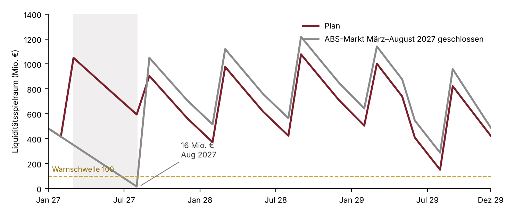
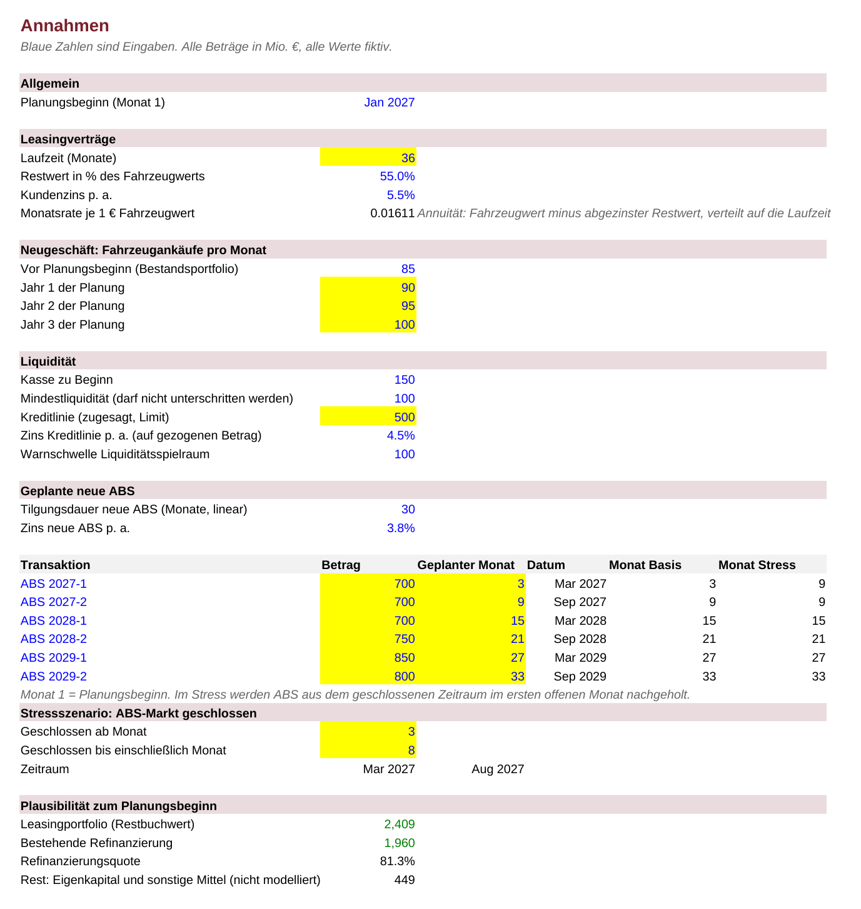
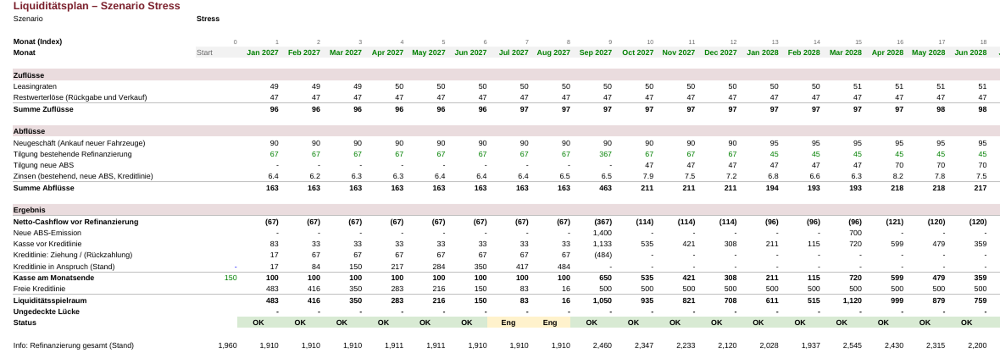

# Liquiditätsplanung für ein Leasingportfolio

Excel-Modell zu einer Kernfrage der Treasury-Arbeit bei Captive-Finanzgesellschaften:
**Reicht die Liquidität Monat für Monat – auch wenn der ABS-Markt vorübergehend schließt?**

Ein Leasinganbieter zahlt die Fahrzeuge sofort und bekommt das Geld erst über Jahre zurück (Raten und Restwerte). Die Lücke wird über ABS, Bankkredite, Schuldscheine und eine revolvierende Kreditlinie refinanziert. Das Modell plant 36 Monate rollierend und stellt dem Plan ein Stressszenario gegenüber.

Alle Zahlen sind erfunden. Die Struktur der Refinanzierung orientiert sich an den öffentlich berichteten Instrumenten einer Autobank.

## Ergebnis

| | Plan | ABS-Markt geschlossen (Mär–Aug 2027) |
|---|---|---|
| Minimaler Liquiditätsspielraum | 151 Mio. € (08/2029) | **16 Mio. € (08/2027)** |
| Maximale Inanspruchnahme der Kreditlinie | 349 von 500 Mio. € (70 %) | **484 von 500 Mio. € (97 %)** |
| Ungedeckte Lücke | keine | keine |

Im Plan trägt sich das Portfolio: Die halbjährlichen ABS füllen die Kasse, die Kreditlinie dient nur zur Überbrückung dazwischen.

**Der kritische Punkt liegt im August 2027.** Dort fällt das Ende der Marktschließung mit der Tilgung eines Bankkredits über 300 Mio. € im September zusammen. Die Linie ist zu 97 % gezogen, der Puffer beträgt noch 16 Mio. €.

**Sensitivität:** Dauert die Schließung einen Monat länger, entsteht im September 2027 eine ungedeckte Lücke von 350 Mio. €. Der Engpass entsteht also nicht durch das laufende Geschäft, sondern durch das Zusammentreffen von geschlossenem Markt und einer großen Fälligkeit.

**Maßnahmen, die sich daraus ableiten:** Fälligkeiten stärker staffeln, die Kreditlinie am Fälligkeitsprofil statt am Durchschnittsbedarf dimensionieren, ABS-Emissionen vorziehen, wenn das Fenster offen ist.

## Aufbau

| Blatt | Inhalt |
|---|---|
| `Annahmen` | alle Eingaben: Neugeschäft, Kreditlinie, geplante ABS, Stresszeitraum |
| `Portfolio` | Leasingverträge nach Ankaufsmonat (96 Kohorten): Rate, Restwert, Rückgabemonat |
| `Refinanzierung` | bestehende ABS, Bankkredite und Schuldschein mit Tilgungsprofil |
| `Plan_Basis` / `Plan_Stress` | die eigentliche Planung, identisch aufgebaut |

Die Logik je Monat: Zuflüsse (Raten, Restwerterlöse) minus Abflüsse (Fahrzeugankäufe, Tilgungen, Zinsen) ergibt den Netto-Cashflow. Neue ABS füllen die Kasse. Fällt sie unter die Mindestliquidität von 100 Mio. €, wird die Kreditlinie gezogen; Überschüsse zahlen sie zuerst zurück.

## Dateien

- `Liquiditaetsplanung_Leasing.xlsx` – das Modell (nur Formeln, kein VBA)
- `Kurzanalyse_Liquiditaetsplanung.pdf` – Ergebnis und Einordnung auf einer Seite

## Grenzen

- Alle Zahlen sind fiktiv und bilden kein reales Unternehmen ab.
- Keine Zahlungsausfälle, keine vorzeitigen Vertragsenden, Restwerte werden voll erlöst.
- Neue ABS tilgen linear; echte ABS tilgen im Takt der Raten und Restwerte des verbrieften Pools.
- Feste Durchschnittszinsen; Bereitstellungsprovision für die Kreditlinie, Gebühren, Steuern und Konzernfinanzierung bleiben außen vor.
